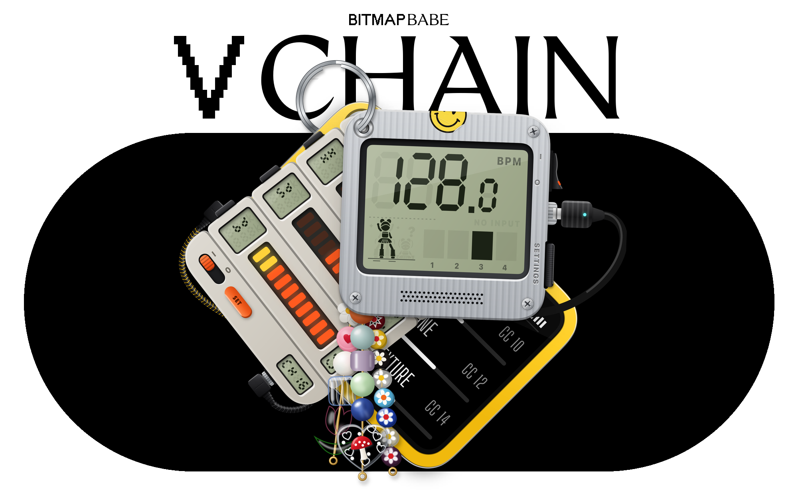

<p align="center">
  
</p>

<h1 align="center">vChain</h1>

<p align="center">
  <b>Audio analysis and BPM detection, simple and where you need it. Made for VJs.</b><br>
  A macOS menu bar app: BPM and beat phase over Ableton Link, drum hits and audio analysis as MIDI.
</p>

<p align="center">
  <a href="https://github.com/nikinoldin/vchain/releases/latest/download/vChain.dmg"><b>Download vChain.dmg</b></a>
  &nbsp;·&nbsp; macOS 15 or later &nbsp;·&nbsp; Apple Silicon and Intel &nbsp;·&nbsp; free software (GPL-3.0-or-later)
</p>

vChain works with any app that speaks Ableton Link or MIDI (Resolume Arena, TouchDesigner, Ableton Live, a lighting
desk, …): BPM and beat phase over Ableton Link, drum hits and audio-analysis values as 14-bit MIDI CC (channel 16 by
default) on the virtual port "vChain".

## Install

Download **[vChain.dmg](https://github.com/nikinoldin/vchain/releases/latest/download/vChain.dmg)**, open it and drag
vChain into Applications.

vChain isn't registered with Apple, so macOS blocks it the first time: open it once, click Done, then
System Settings › Privacy & Security › **Open Anyway**. After that it updates itself.

## Using it

vChain lives in the menu bar: the BPM next to a little dancer who moves on the beat. Click it (or the Dock icon)
to open the keychain with its three modules; click a module to bring it to the front.

- **Beat-o-Matic** shows the BPM and the beats of the bar, and sends the tempo over Ableton Link.
- **BandsDance** sends drum hits as MIDI: kick, snare and hats with three bands, frequency bands with 2 or 4–8.
- **Annalisa** sends six values describing the music: loudness, intensity, brightness, tone, change and texture.

Each module's **SET** button opens its settings; the input (System Audio or a device) is under General.
Right-click the keychain to restart the input or quit.

**Connecting your software:** turn on Ableton Link to follow the tempo, and enable "vChain" as a MIDI input.
To map a value, pull the module's MIDI OUT plug (learn mode), start MIDI learn in your software and click the band
or row you want: vChain sends just that one. Plug it back in to send everything.

| CC | Value |
|----|-------|
| 1–8 | BandsDance (with three bands: 1 kick, 2 snare, 3 hats) |
| 9–14 | Annalisa: loudness, intensity, brightness, tone, change, texture |

All CCs are 14-bit, on MIDI channel 16 by default (each module's channel can be changed in its settings).

## Build and run

```bash
git submodule update --init --recursive  # once (Ableton Link, aubio)
./build.sh && open "build/vChain.app"
```

Needs macOS 15 and the Command Line Tools (no Xcode). The first time you pick System Audio, macOS asks
for Screen & System Audio Recording permission; an input device asks for Microphone permission.

SwiftPM is called with `--build-system native` (the scripts pass it; a plain `swift build` fails with this package).

**The beat-tracking model.** The hybrid beat tracker uses [Beat This!](https://github.com/CPJKU/beat_this) (MIT) as a
Core ML model. It isn't in git (39 MB): `bench/nn/make_model.sh` converts it once (needs [uv](https://docs.astral.sh/uv/)
and the venv from `bench/tools/annotate.sh`) into
`~/Music/vChainBench/models/beat_this_final0_T600_fp16.mlpackage`, and `build.sh` bundles it from there
(`VCHAIN_NN_MODEL=<path>` for another location). Without it the build prints a warning and the app runs drum-only:
the same tracker without the network, worse on DnB and on some real club masters, and it never sets Link's 1. See
docs/beat-tracking.md.

## Development

- `./build.sh` — release build → `build/vChain.app`, signed with the "vChain Dev"
  certificate so permissions survive rebuilds. Without that certificate in the keychain it signs ad-hoc (with a
  warning); macOS then asks for the Screen Recording/Microphone permissions again after each rebuild. A failed
  build fails the script. `UNIVERSAL=1 ./build.sh` also builds for Intel and merges both (releases do).
- `scripts/run-dev.sh <audio file> [args]` — a separate "vChain Dev" copy that plays the file instead
  of capturing (no permission prompts), uses its own prefs and the MIDI port "vChain Dev", and never
  takes focus. It does join Ableton Link. Prints the pid.
- `scripts/screenshot.sh <pid> out.png` — capture each window of that process (needs an unlocked screen);
  `-debugSnapshot <dir>` writes the windows offscreen instead (works while locked; grouped Forms come out blank).
- The dev copy is a menu bar item too. Open its keychain (toggles) with
  `osascript -e 'tell application "System Events" to tell process "VChainDev" to perform action "AXPress" of menu bar item 1 of menu bar 2'`.
- `scripts/make-icon.sh` — regenerates the app icon (assets/AppIcon.icns + 1024 px AppIcon.png): the BPM tag
  on a flat white rounded square on the macOS icon grid, drawn by the app's own views
  (`-debugRenderIcon`). Rerun it when the BPM tag changes. Filling the grid keeps macOS 26 from putting it on its
  grey tile, so it's one icon in Finder and the Dock, closed or running.
- `WEBSITE=<website repo> uv run --with pillow python scripts/readme/hero.py [vector dir]` — the picture at the top of
  this README (assets/readme-hero.png): the vChain wordmark and the keychain from the vector export. Rerun it (after
  `scripts/export-vector.sh`) when the keychain changes.
- `scripts/export-vector.sh [dir]` — the three modules and the keychain as PDFs and SVGs, light and dark
  (default `build/vector`; SVGs need `brew install poppler`).
- `scripts/release.sh [--publish [patch|minor|major]]` — `dist/vChain.dmg` (app, Applications link and the first-launch steps in
  the BitmapBabe frame, `scripts/dmg/background.py`), a full source zip and the Sparkle appcast; `--publish` asks for patch, minor or major,
  raises the version, commits and makes the GitHub release. Updates: the app checks bitmapbabe.com/vchain/appcast.xml daily (Sparkle).
  Needs the Beat This! model (above), [uv](https://docs.astral.sh/uv/) (for dmgbuild in `.cache/release-venv`), the
  Sparkle EdDSA private key in the login keychain under the account "vchain" (signs the appcast; Sparkle's tools are
  downloaded into `.cache/sparkle`), and for `--publish` the [GitHub CLI](https://cli.github.com) `gh`, logged in,
  with `main` pushed.
- `scripts/check.sh` — the VChainKit checks (geometry, pendulum, seven-segment, descriptor mask, spectrum
  bands; XCTest isn't available with the Command Line Tools, so they're a plain executable), then the beat bench's
  unit checks and synthetic scenarios (`VChainBench`, offline, never joins Link; bench/README.md). Run it before
  committing.
- Launch switches: `-forceAppearance dark|light`, `-debugOpen settings|modules`
  (`modules` is the developer gallery of the modules; `-modulesPage bpm|midi|power|energy|keychain`),
  `-settingsPane general|bpm|midi|energy`, `-debugInputProblem 3|4`, `-testAudioFile`, `-midiPortName`
  (DebugLaunch.swift).

Architecture: ARCHITECTURE.md. Beat tracking: docs/beat-tracking.md. Conventions and gotchas: CLAUDE.md.

## Licence

vChain is Copyright (C) 2026 Niki Noldin and free software under the GNU General Public License, version 3 or (at
your option) any later version: see LICENSE. Source: https://github.com/nikinoldin/vchain. It includes aubio (GPL-3.0+), Ableton Link (GPL-2.0+), asio (Boost), the
Beat This! model and code ported from it (MIT), Sparkle (MIT) and the Big Shoulders Display font (OFL); their notices are in THIRD_PARTY_NOTICES.md, which
also ships inside the app. The names vChain and BitmapBabe and the BitmapBabe logo are not covered by the GPL.
